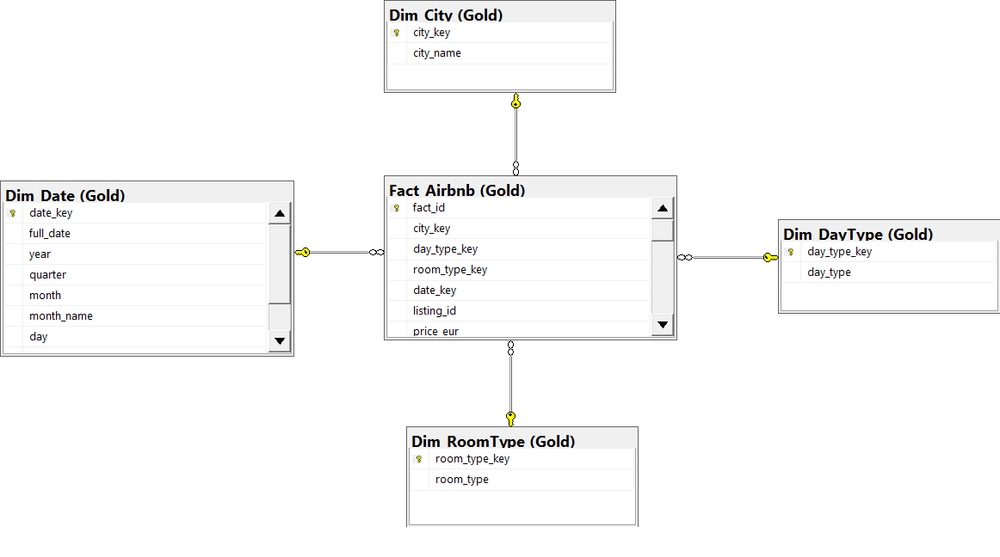

# Airbnb Data Warehouse: SQL Server + Power BI

End-to-end data warehouse analyzing Airbnb listings across 10 European cities
(Amsterdam, Athens, Barcelona, Berlin, Budapest, Lisbon, London, Paris, Rome, Vienna),
built with a Medallion Architecture (Bronze → Silver → Gold) and an interactive Power BI report.

## Architecture

| Layer | What it does |
|---|---|
| **Bronze** | 20 raw tables (10 cities × weekday/weekend) plus data quality checks: NULL counts, invalid prices/capacities/distances, and `room_type` text consistency |
| **Silver** | One unified table, `Silver.Fact_Airbnb_Cleaned`: `TRY_CAST` on all columns, currency symbols and commas removed from price, text standardized, flags cast to `BIT`, columns renamed |
| **Gold** | Star schema: `Fact_Airbnb` + `Dim_City`, `Dim_DayType`, `Dim_RoomType`, `Dim_Date`, with Primary and Foreign Keys. The script is re-runnable |

## Power BI Report (3 pages)

1. **Executive Overview:** total listings, price range, average price; listings and average price by city; room type distribution
2. **City & Capacity Details:** average capacity, bedrooms and price per guest; city comparison table; business-listing filter
3. **Trend & Satisfaction Analysis:** average satisfaction, superhost cleanliness, restaurant and attraction indexes, and distance to center and metro by price category

All pages include slicers for city, room type and day type.

## Files

- `DDL_and_Bronze_SQL`: database and Bronze schema creation, data quality checks
- `Siver_layers`: Silver layer cleaning and consolidation
- `Gold_layers`: Gold star schema build
- `project_Sgl.pbix`: Power BI report
- `Project_Diagram.png`: data model diagram

## How to Run

1. Run the Bronze script to create `Airbnb_DW` and the `Bronze` schema
2. Import the raw city files into the Bronze schema
3. Run the Silver script, then the Gold script
4. Open `project_Sgl.pbix` in Power BI Desktop and refresh the data

## Tools

SQL Server · T-SQL · Power BI · DAX · Star Schema · Medallion Architecture
